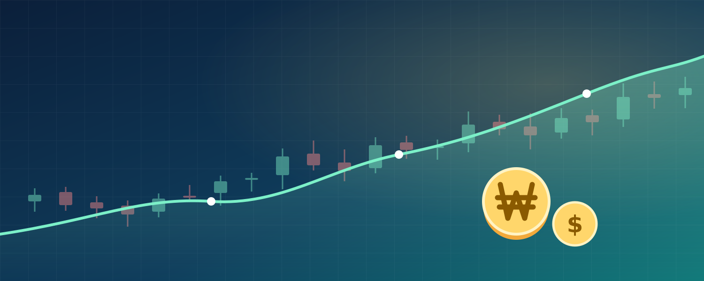

# 📈 경린이 탈출하기: 용어부터 뉴스까지, 경제 처음부터 공부하기

경제를 완전 처음 공부하는 사람이 **용어 → 원리 → 뉴스 → 내 돈** 순서로 경제를 읽을 수 있게 되는 것을 목표로 하는 저장소입니다.
[HR 저장소](https://github.com/dhcoaud98/HR)의 구조(데일리 브리핑 + 용어집 + 뉴스 MCP 서버)를 그대로 가져와 경제 주제로 바꿨습니다.



## 🎯 이 저장소의 목적

"경제 뉴스를 읽으면 단어부터 막힌다"에서 출발해, 금리·물가·환율 뉴스를 스스로 읽고 내 생활에 연결할 수 있게 되는 것이 목표입니다. 세 가지를 함께 합니다.

1. **매일 읽기:** 데일리 브리핑으로 용어 2개, 뉴스 3개, 핵심 숫자 3개를 매일 조금씩 쌓습니다.
2. **단어 쌓기:** 브리핑에 나온 용어를 꼭 알기 / 대충 알기 / 몰라도 됨으로 나눠, 알아야 할 만큼만 익힙니다.
3. **내 말로 정리하기:** 뉴스마다 "금리·물가·환율·성장 중 무엇과 연결될까?"를 한 줄로 이어 보며 경제의 연결고리를 손에 익힙니다.

## 🗺 학습 로드맵

다섯 단계로 나누고, 앞 단계부터 차근차근 넓혀 갑니다. ✅는 이 저장소에 장치가 있는 것, ⬜는 앞으로 채울 것입니다.

| 단계 | 기간 | 공부할 핵심 | 이 저장소에서 |
|---|---|---|---|
| 1 | 1~2주 | **기본 용어:** 수요·공급, GDP, 인플레이션, 금리, 환율 | ✅ 브리핑 📘 오늘의 용어 (1~30일차, 60개) · `glossary/` |
| 2 | 1~2달 | **연결고리:** 물가↑ → 금리↑ → 소비↓, 미국 금리↑ → 달러 강세 → 환율↑ | ✅ 브리핑 📰 "연결고리" 한 줄 · ❓ 생각해볼 질문 |
| 3 | 계속 | **뉴스 읽기 습관:** 하루 1~2개, 모르는 단어는 용어집으로 | ✅ 브리핑 📰 · `econ-news/` |
| 4 | 계속 | **지표 직접 보기:** 기준금리, 소비자물가, 환율, 연준 결정 | ✅ 브리핑 📊 숫자 한눈에 보기 / ⬜ 지표 추이 실습 |
| 5 | 이후 | **내 돈에 연결하기:** 예금·대출·주식·채권이 금리·환율에 따라 움직이는 이유 | ⬜ 실습 예정 |

**추천 순서:** 매일 브리핑 읽기 → 막히는 단어는 용어집에서 확인 → 궁금한 주제는 `econ-news`로 더 찾아 읽기 → 금요일에 용어집 주간 체크

| 구성 | 한 마디 정의 | HR 저장소에서 이어지는 부분 |
|---|---|---|
| [`briefings/`](briefings/) | Claude가 매일 아침 용어·뉴스·숫자를 골라 **알아서 올려 주는** 데일리 브리핑 | `briefings/` (Claude 예약 작업) |
| [`glossary/`](glossary/) | 브리핑에 나온 경제 용어를 판정과 함께 쌓는 용어집 | `glossary/` (스크립트 동일) |
| [`econ-news/`](econ-news/) | 금리·물가·환율 뉴스를 찾아 읽고 공부노트에 쌓는 MCP 서버 | `hr-news/` |

- **briefings 핵심:** 내가 묻지 않아도 매일 아침 도착한다. 30일 동안 기초 용어 60개를 순서대로 익힌다.
- **glossary 핵심:** 모든 단어를 외우지 않는다. 🔴만 확실히, 🟡는 한 줄, ⚪는 건너뛴다.
- **econ-news 핵심:** 도구가 신문을 가져다주고, Claude가 쉽게 풀어 주고, 나는 "내 말로 이해한 것" 한 줄만 남긴다.

## 📬 경제 공부 브리핑 → [`briefings/`](briefings/)

매일 아침 7시 43분(한국 시간), Claude 예약 작업이 웹에서 경제 소식을 모아 쉽게 풀어 쓴 뒤 이 저장소에 올립니다.

- **구성:** 📘 오늘의 용어 2개 / 📰 뉴스 3개(한국 2·해외 1) / 📊 기준금리·환율·코스피 / 📚 읽을거리 / ❓ 생각해볼 질문
- **진도:** 2026-11-20이 1일차. 1~30일차는 정해진 용어 60개, 31일차부터는 그날 뉴스에서 고른 용어
- **일요일:** 그 주 용어로 복습 퀴즈 5문제
- **위치:** `briefings/YYYY/MM/YYYY-MM-DD.md`
- **목록:** [briefings/README.md](briefings/README.md)

```
매일 07:43 → Claude 예약 작업(클라우드) → 웹 검색 → 브리핑 작성 → 용어집 갱신 → 이 저장소에 커밋·푸시
```

## 📖 경제 용어집 → [`glossary/`](glossary/)

브리핑을 다 쓴 뒤, 같은 예약 작업이 브리핑에 나온 경제 용어를 뽑아 용어집에 쌓습니다. 낯선 용어 때문에 기사를 읽다 멈추지 않도록 **알아야 할 만큼만** 알려 주는 게 목표입니다. (HR 용어집과 같은 방식)

- **판정:** 🔴 꼭 알기(뉴스에 계속 나옴) / 🟡 대충 알기(한 줄 뜻만) / ⚪ 몰라도 됨(넘어가도 됨)
- **뜻풀이:** 경제 처음 공부하는 사람 눈높이 1~2문장 + "왜 중요"
- **분야:** 기초 개념 / 시장·가격 / 성장·경기 / 물가 / 금리·통화 / 환율·무역 / 금융·투자 / 정책·기관
- **자동 승격:** 같은 용어가 3일 나올 때마다 한 단계씩 올라갑니다 (⚪ → 🟡 → 🔴)
- **자동 접기:** ⚪ 용어가 30일 넘게 안 나오면 목록에서 접히고, 다시 나오면 돌아옵니다
- **주간 체크:** 매주 금요일 올라오는 [용어집 주간 체크 Issue](https://github.com/dhcoaud98/economy/issues?q=label%3A%EC%9A%A9%EC%96%B4%EC%A7%91)에서 이미 아는 용어를 체크하면, 다음 날 아침 '이제 아는 용어'로 옮겨집니다

| 파일 | 내용 |
|---|---|
| [glossary/README.md](glossary/README.md) | 전체 용어 목록 (판정별) |
| `glossary/daily/YYYY/MM/YYYY-MM-DD.md` | 그날 새로 나온 용어 + 다시 나온 용어 |
| `glossary/terms.json` | 원본 데이터 |
| `glossary/build.py` · `weekly.py` | 목록 생성 · 주간 체크 반영 스크립트 |

```
브리핑 작성 → 용어 뽑기 → terms.json 갱신 → build.py로 목록 생성 → 일별 용어 파일 → 브리핑과 한 커밋으로 푸시
```

## 📖 세 가지 사용법

세 가지는 역할이 다릅니다. **브리핑은 배달**(가만히 있어도 옴), **용어집은 사전**(막힐 때 펼쳐 봄), **econ-news는 가판대**(궁금할 때 가서 찾음)입니다.

### 1. 📬 브리핑: 매일 아침 10분 읽기

설치할 것이 없습니다. GitHub에서 [briefings/README.md](briefings/README.md)를 열면 최신순 목록이 있습니다.

1. 출근길에 오늘 브리핑을 엽니다. "오늘의 한 줄"로 흐름을 먼저 잡습니다.
2. 📘 오늘의 용어 2개를 **내 말로 한 문장씩** 설명해 봅니다.
3. 📰 뉴스 3개 중 하나만 골라 "연결고리"를 읽고, 같은 흐름이 다른 뉴스에도 있는지 찾아봅니다.
4. ❓ 질문에 답을 먼저 생각한 뒤 정답을 펼쳐 봅니다.

### 2. 📖 용어집: 막힐 때 펼쳐 보기

- 뉴스를 읽다 모르는 단어가 나오면 [glossary/README.md](glossary/README.md)에서 찾아봅니다.
- 🔴는 뜻과 "왜 중요"까지, 🟡는 한 줄만, ⚪는 건너뜁니다.
- 금요일에는 주간 체크 Issue에서 이제 아는 용어를 체크합니다. 체크한 용어는 다시 설명하지 않습니다.

### 3. 📰 econ-news: 궁금한 주제를 더 파고들기

브리핑에서 본 주제가 궁금할 때 씁니다. Claude Desktop에 연결해 두면 대화로 바로 부를 수 있습니다. 사용법은 [econ-news/README.md](econ-news/README.md)에 있습니다.

### 🔁 세 가지를 엮은 한 주 루틴 (예시)

| 언제 | 무엇을 | 사용 |
|---|---|---|
| 매일 아침 10분 | 브리핑 읽고 용어 2개를 내 말로 설명해 보기 | 📬 브리핑 |
| 주 2~3회 10분 | 브리핑에서 궁금했던 주제 하나를 더 찾아 읽고 한 줄 저장 | 📰 `econ_news` → `save_reading` |
| 금요일 10분 | 용어집 주간 체크 + 공부노트로 한 주 돌아보기 | 📖 Issue 체크 · 📰 `list_readings` |
| 일요일 5분 | 브리핑의 복습 퀴즈 5문제 풀기 | 📬 브리핑 |

## 📚 함께 볼 자료

- **무료:** [KDI 경제교육·정보센터](https://eiec.kdi.re.kr/), 한국은행 경제교육 자료
- **입문 읽을거리:** 팀 하포드 『경제학 콘서트』 (일상 사례로 경제 원리를 설명)
- **거시 흐름 잡기:** 오건영 『부의 시나리오』 (금리·환율·물가의 연결)
- **교과서(사전처럼 사용):** 『맨큐의 경제학』

## 🧰 준비물 (econ-news를 쓸 때만)

브리핑과 용어집은 GitHub에서 읽기만 하면 되므로 준비물이 필요 없습니다.

| 준비물 | 용도 | 확인 방법 |
|---|---|---|
| Python 3.10 이상 | 서버 실행 | `python --version` |
| [uv](https://docs.astral.sh/uv/) | 패키지 설치·실행 | `uv --version` |
| [Claude Desktop](https://claude.ai/download) | 서버를 Claude와 연결해 대화로 쓰기 | 앱 실행 |
| 인터넷 연결 | Google 뉴스 RSS 읽기 | |

## ▶️ 실행하기

```bash
git clone https://github.com/dhcoaud98/economy.git
cd economy/econ-news
uv sync
uv run test_client.py
```

Claude Desktop의 **설정 → 개발자 → 설정 편집**에서 `claude_desktop_config.json`의 `mcpServers`에 추가합니다. 경로는 내 컴퓨터의 실제 폴더 경로로 바꿉니다.

```json
{
  "mcpServers": {
    "econ-news": {
      "command": "uv",
      "args": ["--directory", "C:\\Users\\내이름\\economy\\econ-news", "run", "server.py"]
    }
  }
}
```

Claude Desktop을 완전히 종료했다가 다시 실행하면 도구 메뉴에 `econ-news`가 보입니다. 막힐 때는 [HR 저장소의 '막힐 때' 표](https://github.com/dhcoaud98/HR#막힐-때)와 같은 순서로 확인하면 됩니다.

## 🖼 노션용 이미지 → [`assets/`](assets/)

노션 "경린이 탈출하기" 페이지에 쓰는 아이콘과 커버입니다.

| 파일 | 크기 | 용도 |
|---|---|---|
| [`notion-icon.png`](assets/notion-icon.png) | 512×512 | 페이지 아이콘 (아이콘 추가 → 업로드) |
| [`notion-cover.png`](assets/notion-cover.png) | 1500×600 | 페이지 커버 (커버 추가 → 업로드) |

## 폴더 구조

```
economy/
├── README.md            ← 지금 보는 파일
├── briefings/           ← 📬 경제 공부 브리핑 (매일 자동 추가)
│   ├── README.md
│   └── 2026/11/2026-11-20.md ...
├── glossary/            ← 📖 경제 용어집 (브리핑과 함께 자동 갱신)
│   ├── README.md        ← 전체 용어 목록 (build.py가 생성)
│   ├── terms.json
│   ├── build.py · weekly.py
│   └── daily/2026/11/2026-11-20.md ...
├── econ-news/           ← 📰 경제 뉴스 MCP 서버 (금리·물가·환율)
│   ├── README.md
│   ├── server.py
│   ├── test_client.py
│   └── pyproject.toml
└── assets/              ← 🖼 노션 아이콘·커버
```

## 앞으로 넓혀 볼 주제

- 지표 추이 실습: 기준금리·환율·물가를 표로 쌓아 흐름 읽어 보기 (hr-analytics 같은 연습장)
- 내 돈에 연결하기: 금리가 오를 때 예금·대출 이자가 어떻게 바뀌는지 계산해 보기
- 31일차 이후: 그날 뉴스 용어 중심으로 바뀐 뒤, 한 달 단위로 "가장 많이 나온 용어" 돌아보기
